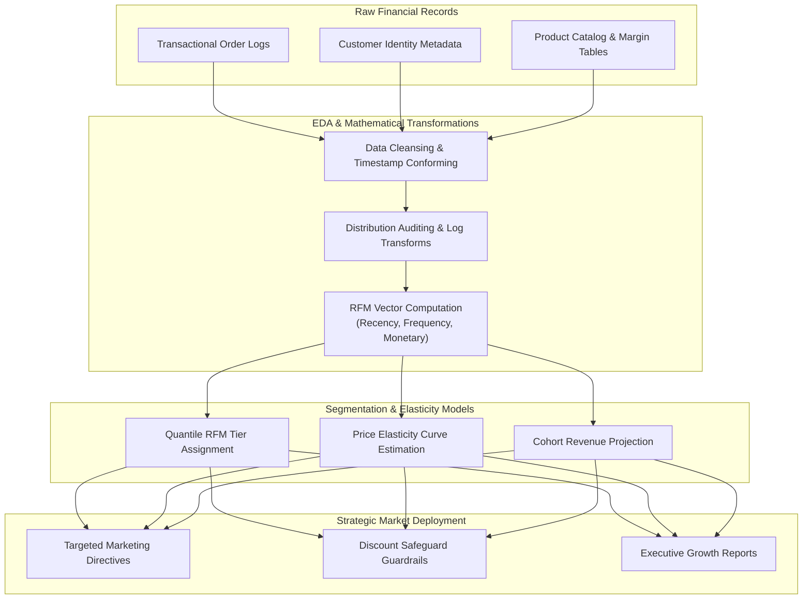

<div align="center">

<a href="https://github.com/akashvenkey/Business-Analytics.1">

</a>


### 🔗 **Project Source Link:** [https://github.com/akashvenkey/Business-Analytics.1](https://github.com/akashvenkey/Business-Analytics.1)

[](https://github.com/akashvenkey/Business-Analytics.1)
[](https://github.com/akashvenkey/Business-Analytics.1.git)

[](https://github.com/akashvenkey/Business-Analytics.1)
[](https://github.com/akashvenkey/Business-Analytics.1)
[](#)
[-blue?style=for-the-badge)](https://www.alliance.edu.in/)
[](#)

</div>

---

## 📌 Executive Summary & Overview

Financial markets and retail ecosystems generate multidimensional transactional streams that require advanced statistical exploration to reveal actionable patterns. Traditional aggregate reporting often conceals critical variance, customer churn precursors, and uneven revenue distributions.

The **Financial & Market Analytics** repository focuses on **Advanced Exploratory Data Analysis (EDA)**, **RFM (Recency, Frequency, Monetary) Customer Segmentation**, and **Predictive Revenue Modeling**. By decomposing consumer purchase behaviors into quantifiable vectors, this project provides the mathematical foundations required to identify high-value customer clusters, simulate price elasticity, detect anomalous transaction spikes, and forecast recurring cash flows.

---

## 📑 Interactive Table of Contents

- [📌 Executive Summary & Overview](#-executive-summary--overview)
- [✨ Key Features & Capabilities](#-key-features--capabilities)
- [🎯 RFM Segmentation Methodology](#-rfm-segmentation-methodology)
- [🏗 System Architecture & Analytical Pipeline](#-system-architecture--analytical-pipeline)
- [🛠 Tech Stack Breakdown](#-tech-stack-breakdown)
- [🚀 Reproducible Quickstart & Setup](#-reproducible-quickstart--setup)
- [📂 Project Directory Layout](#-project-directory-layout)
- [👨‍💻 Author & Contributions](#-author--contributions)

---

## ✨ Key Features & Capabilities

- **🎯 RFM Behavioral Segmentation:** Mathematical scoring of customer recency (days since last purchase), purchase frequency (transaction count), and monetary value (total spend) to classify users into Champions, Loyal Customers, At-Risk, and Hibernating tiers.
- **📊 Advanced Exploratory Data Analysis (EDA):** Skewness corrections, log transformations, kernel density estimations (KDE), and correlation heatmap evaluations across revenue drivers.
- **🏷 Price Elasticity & Discount Optimization:** Regression models estimating demand elasticity ($\epsilon_d = \frac{\% \Delta Q}{\% \Delta P}$) to determine discount tipping points that maximize net profit without eroding brand equity.
- **🚨 Outlier Detection & Anomaly Auditing:** Interquartile Range (IQR) and Z-score protocols identifying fraudulent purchase spikes or anomalous transactional refunds.
- **🔮 Time-Series Trend Decomposition:** Additive and multiplicative trend decomposition separating baseline seasonal fluctuations from secular growth.

---

## 🎯 RFM Segmentation Methodology

```plaintext
┌─────────────────────────────────────────────────────────────────────────────┐
│                         RFM ANALYTICAL MATRIX                               │
├────────────────────┬────────────────────┬───────────────────────────────────┤
│ Dimension          │ Definition         │ Analytical Formula                │
├────────────────────┼────────────────────┼───────────────────────────────────┤
│ Recency (R)        │ Inactivity window  │ R = Reference_Date - Max(Order_Dt)│
│ Frequency (F)      │ Loyalty velocity   │ F = Count(Distinct Order_IDs)     │
│ Monetary (M)       │ Financial impact   │ M = Sum(Order_Net_Revenue)        │
└────────────────────┴────────────────────┴───────────────────────────────────┘

┌───────────────┬──────────────────────────────────┬──────────────────────────┐
│ Segment Tier  │ RFM Profile Score Range          │ Recommended Action       │
├───────────────┼──────────────────────────────────┼──────────────────────────┤
│ Champions     │ High R (5), High F (5), High M (5)│ VIP Rewards, Early Access │
│ Loyal Adopters│ Mid R (3-4), High F (4-5), Mid M  │ Cross-sell, Upsell Offers│
│ At Risk       │ Low R (1-2), High F (4-5), High M │ Urgent Win-back Discounts │
│ Hibernating   │ Low R (1), Low F (1), Low M (1-2) │ Low-cost Email Re-engage │
└───────────────┴──────────────────────────────────┴──────────────────────────┘
```

---

## 🏗 System Architecture & Analytical Pipeline

The following architectural flowchart demonstrates the data pipeline from raw financial records to segmented cluster insights:



---

## 🛠 Tech Stack Breakdown

| Category | Tools & Techniques | Description |
| :--- | :--- | :--- |
| **Statistical Techniques** | RFM Modeling, Price Elasticity, EDA | Behavioral clustering, sensitivity curves, quantile ranking |
| **Analytical Software** | Python (Pandas, SciPy), Power BI, Excel | Vector calculations, statistical aggregation, pivot structures |
| **Visualization** | Heatmaps, Scatter Elasticity, Histograms | Distribution plots, correlation matrices, cluster maps |
| **Data Formats** | CSV, JSON, Parquet, Relational Tables | Clean schema definitions and time-series transactional records |
| **Documentation** | Technical Markdown & Mathematical Notation | Formalized methodology papers and analytical blueprints |

---

## 🚀 Reproducible Quickstart & Setup

### Prerequisites
- Python 3.9+ or Microsoft Excel / Power BI Desktop
- Standard Git CLI

### Exploration Workflow
```bash
# 1. Clone this repository
git clone https://github.com/akashvenkey/Business-Analytics.1.git

# 2. Navigate into project directory
cd Business-Analytics.1

# 3. Explore repository files
ls -la
```

---

## 📂 Project Directory Layout

```plaintext
Business-Analytics.1/
├── datasets/           # Structured financial records and customer transaction tables
├── notebooks/          # Exploratory data analysis, RFM segmentation and elasticity code
├── reports/            # Analytical findings, cohort retention curves, and visual charts
└── README.md           # Mathematical formulations, RFM definitions & project guide
```

---

## 👨‍💻 Author & Contributions

**Akash V**  
- **GitHub:** [@akashvenkey](https://github.com/akashvenkey)  
- **Specialization:** Financial Analytics, RFM Modeling & Market Intelligence  
- **Academic Program:** BCA (Hons), Alliance University, Bangalore  

Contributions of financial datasets, pricing algorithms, and retention models are welcome. If you find these analytical methodologies useful, please leave a ⭐!

---

<div align="center">

<a href="https://github.com/akashvenkey/Business-Analytics.1">

</a>


### 🔗 **Project Source Link:** [https://github.com/akashvenkey/Business-Analytics.1](https://github.com/akashvenkey/Business-Analytics.1)

[](https://github.com/akashvenkey/Business-Analytics.1)
[](https://github.com/akashvenkey/Business-Analytics.1.git)

</div>